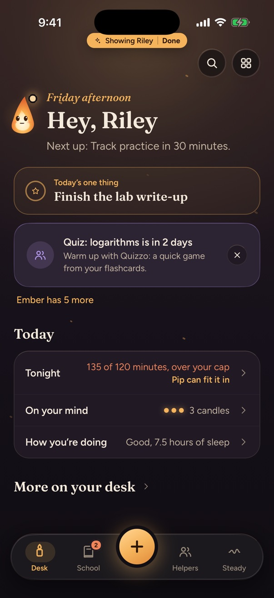
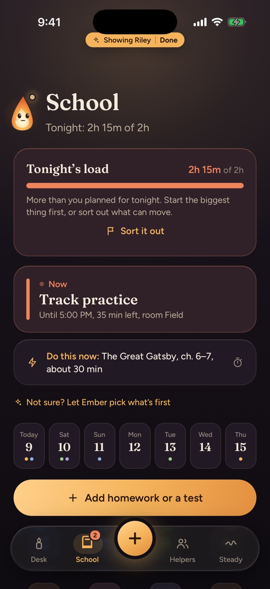
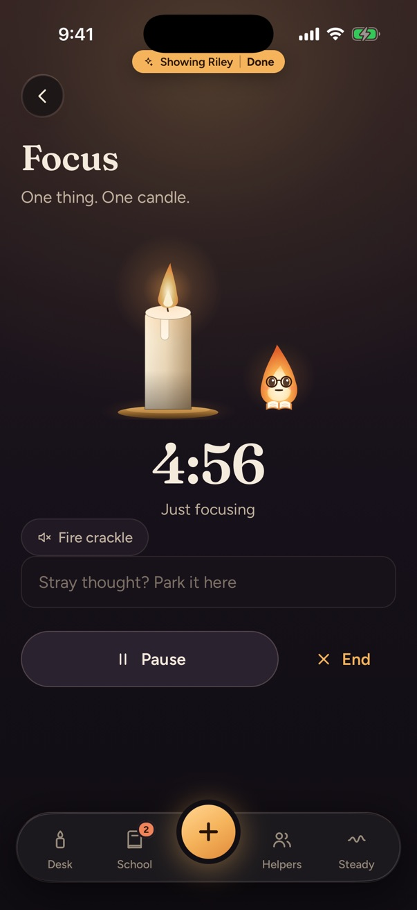
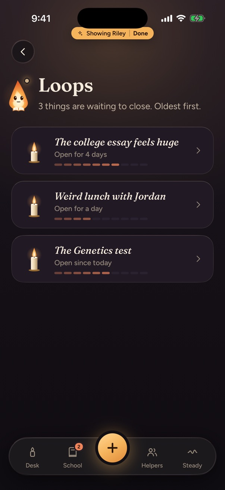
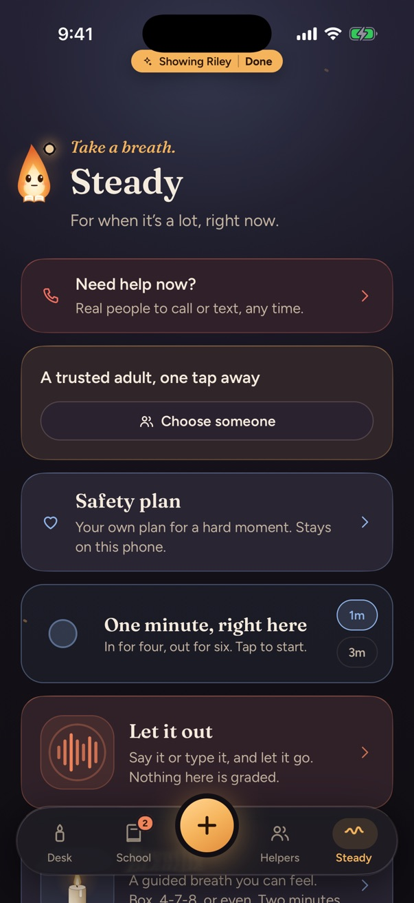

# Hi, I'm Peter Nunley 👋

I build calm, practical software for real-world operations, students, and local communities — ranging from native iOS apps and multi-device sync engines to multi-agent pipelines, e-commerce design systems, and interactive dashboards.

---

## 🚀 Featured Repositories & Live Demos

### 1. [🕯️ Brain Navigator](https://github.com/peternunley08-ops/brain-navigator) — *iOS Student Companion App*
  
> **Stack:** React Native 0.86 · Expo SDK 57 · TypeScript · Zustand · Reanimated 4 · Supabase Edge Functions · Swift Widgets

A quiet, local-first iPhone app designed for high school students to keep classes, assignments, focus sessions, and mental clutter from piling up.

<table><tr><td align="center"> <b>Desk:</b> Know what’s next.</td><td align="center"> <b>School:</b> Tonight, at a glance.</td><td align="center"> <b>Focus:</b> One candle. One thing.</td><td align="center"> <b>Mind:</b> Set it down.</td><td align="center"> <b>Steady:</b> Help, always in reach.</td></tr></table>

- **No streaks or guilt:** Accompanied by **Ember**, an ambient candlelit companion that adapts to time of day (*First Light* in the morning, *Night Room* after hours).
- **Playable Web Simulator:** Try the [interactive iPhone 16 Pro web simulator](https://peternunley08-ops.github.io/peternunley08-ops/brain-navigator-demo/) with procedural Web Audio fire crackle, natural-language assignment parsing, and all 6 tabs live in your browser.

---

### 2. [🏊‍♂️ DeckHand — Swim Roster & Lifeguard Sync](https://github.com/peternunley08-ops/swim-roster-ops) — *Multi-Device Aquatics Operations*
   
> **Stack:** React 18 · Vite · Netlify Functions & Blobs · Supabase (RLS + Edge Functions) · Claude Vision API

A real-time roster, attendance, instructor assignment, and rotation platform built for summer swim programs and lifeguard decks.
- **3-Way Optimistic Concurrency Sync:** Multiple instructors can mark attendance and move swimmers simultaneously from poolside phones without overwriting each other's changes (ETag + 3-way state reconciliation in `src/sync.js`).
- **Claude Vision Roster Import & Live Simulators:** Try the **[Playable React App](https://peternunley08-ops.github.io/swim-roster-ops/app/)** featuring **"✨ Try Demo Photo Scan"** and **"🔄 Simulate Co-Instructor Sync (3-Way Merge)"**.

---

### 3. [🪺 AI Systems & Agency OS](https://github.com/peternunley08-ops/ai-systems-and-agency-os) — *Multi-Agent Pipelines & Portfolio Cockpit*
 
> **Stack:** Node.js (Zero-Dependency CLI & Server) · Python 3.12 · Pydantic · Anthropic Claude API · Stripe & Shopify APIs · Google Places API

- **[🪺 Nestral — AI Chief-of-Staff](https://peternunley08-ops.github.io/ai-systems-and-agency-os/nestral/public/index.html):** Connects Shopify & Stripe workspaces into one ranked morning brief (*Momentum*, *Stock Risk*, *Backlog*, *Pending Payments*) with a 7-day trend sparkline and deterministic *"Ask Your Portfolio"* Q&A engine.
- **[🌴 SLO Agency OS](https://peternunley08-ops.github.io/ai-systems-and-agency-os/slo-agency-os/gallery.html):** Automated local web-agency pipeline for San Luis Obispo / Central Coast businesses — lead discovery (`find_leads.py`), 70+ generated multi-style HTML mockups (`gallery.html`), and a [Lead Command Center](https://peternunley08-ops.github.io/ai-systems-and-agency-os/slo-agency-os/lead-command-center.html).
- **[🤖 Agent OS — 6-Agent Business Pipeline](https://peternunley08-ops.github.io/ai-systems-and-agency-os/agent-os/index.html):** Sequential async agent pipeline (`StripeIngest → CEO → DataAnalyst → CMO → SalesRep → Researcher → Developer`) sharing a typed `pydantic` state object with human-quarantined patch review.

---

### 4. [✨ E-Commerce Brand Systems & Shopify OS 2.0](https://github.com/peternunley08-ops/ecommerce-brand-systems) — *LUMÉRA Halo & 4 DTC Brands*
 
> **Stack:** Shopify Online Store 2.0 Liquid (17 Editable Sections) · HTML5/CSS3 Design Systems · WCAG 2.1 AA · Unit-Economics Modeling

- **[LUMÉRA Halo](https://peternunley08-ops.github.io/ecommerce-brand-systems/lumera-halo/):** Original beauty-tech flagship store (*"Calibrated Atelier"* design system), backed by **17 schema-validated Shopify Liquid sections** (`shopify/sections/*.liquid`) and an interactive **Slide-Over Cart & Unit-Economics Drawer**.
- **[4 Single-Product DTC Brands](https://peternunley08-ops.github.io/ecommerce-brand-systems/):** Complete storefronts, supplier sourcing math, and Amazon FBA margin playbooks for **Cinderlux** ([Sauna Blanket](https://peternunley08-ops.github.io/ecommerce-brand-systems/dtc-stores/sauna-blanket/)), **Cariven** ([Red-Light Mask](https://peternunley08-ops.github.io/ecommerce-brand-systems/dtc-stores/red-light-mask/)), **Lunthera** ([Neck Massager](https://peternunley08-ops.github.io/ecommerce-brand-systems/dtc-stores/neck-massager/)), and **Vertabliss** ([Neck Traction](https://peternunley08-ops.github.io/ecommerce-brand-systems/dtc-stores/neck-traction/)).

---

### 5. [⚡ Web Builds, Automations & Dashboards](https://github.com/peternunley08-ops/web-builds-and-dashboards) — *Community Sites & Tools*

> **Stack:** HTML5 / CSS3 / Vanilla JS · Leaflet.js · Google Apps Script · Gemini Vision API

- **[🍩 Donut Dash 5K](https://peternunley08-ops.github.io/web-builds-and-dashboards/donut-dash/):** Community fundraiser site benefiting the **SLO Food Bank** — featuring clickable **Leaflet.js** course checkpoints, a live Donut Time Bonus calculator, and an instant printable **Official Race Bib** generator.
- **[🐾 Northstar Paws](https://peternunley08-ops.github.io/web-builds-and-dashboards/northstar-paws/):** Custom pet-portrait storefront with an interactive **AI Portrait Studio** and a 24/7 **Google Apps Script + Gemini Vision** automated proof pipeline.
- **[💳 Money Dashboard](https://peternunley08-ops.github.io/web-builds-and-dashboards/money-dashboard/?demo=1):** 100% client-side Chase & PayPal CSV budget analyzer pre-loaded with 3 months of synthetic demo data, SVG spending donuts, and editable monthly budgets.
- **[🎛️ Command Center UI](https://peternunley08-ops.github.io/web-builds-and-dashboards/command-center-ui/):** Dark-mode operations cockpit with persistent daily priority rings and a built-in 25m Quick-Focus timer.
